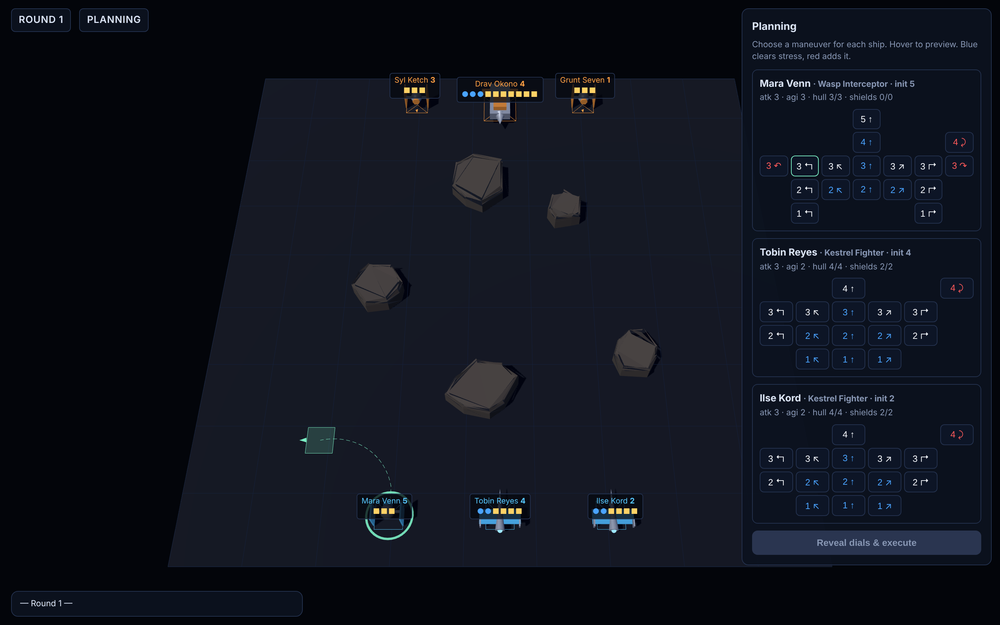
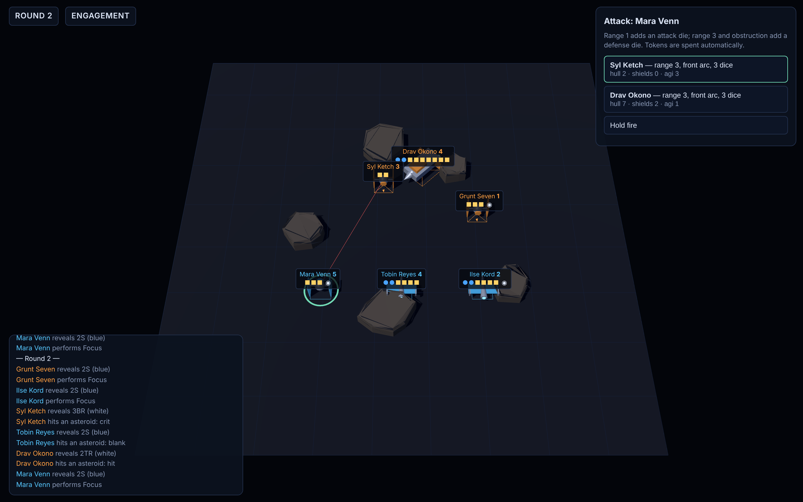

# Squadron Tactics (prototype)

A squadron-commander tactics game prototype: 3D starfighters on a 2D table, using
X-Wing-style (2.0/2.5) maneuver-dial rules. You play a 3-ship squadron against an AI.

See [docs/DESIGN.md](docs/DESIGN.md) for the design, architecture, rules coverage and roadmap.

## Run

```bash
npm install
npm run dev        # http://localhost:5173
npm test           # engine unit tests
npm run typecheck
npm run build:artifact -w @xw/web   # single-file build for claude.ai artifacts (apps/web/dist/artifact.html)
node apps/web/scripts/bake-freighter.mjs path/to/Freighter.fbx   # re-bake the freighter model (source FBX is not in the repo)
node apps/web/scripts/bake-glb.mjs path/to/glb.glb apps/web/src/assets/bomber/bomber.bin --length 42 --cell 0.2 --uv 0.03 --normal 2   # re-bake the bomber (source GLB is not in the repo)
node apps/web/scripts/bake-obj.mjs path/to/Intergalactic_Spaceship.obj apps/web/src/assets/javelin/javelin.bin --size 32 --rot-y 90   # re-bake the Javelin (source OBJ is not in the repo)
```

## How to play

0. **Build your squad.** Each battle starts in the squad builder. Pick a points budget (100 is standard), add pilots (named pilots fly once per battle; call-sign pilots can be taken several times), and fit power-ups into their slots: tap a slot to choose one. Power-ups so far are stat boosts (modifications) and pilot talents for pilots of initiative 3+ (Marksman, Crack Shot, Elusive, Outmaneuver, Hotshot); talents are used automatically when they help, the hit odds include them, and the log notes when one fires. Missiles and torpedoes (Proton and Ion Torpedoes, Concussion Missiles, Rocket Pods) are secondary weapons with limited charges, their own range band and usually a lock requirement; Turrets (Dorsal Turret, Ion Cannon Turret) fire through a 90° turret arc shown in yellow on the base; ships carrying one get a **Rotate** action whose buttons sit around the ship in the direction each facing points (hover to preview the arc). Your squad is remembered, and you can save several. The AI builds its own squad to the same budget (re-roll it if you like). **Deploy** places both squads along their edges; drag your ships within your lit setup area (click to pick up and put down with a mouse), then **Begin battle**. Bombs and mines (Proton Bomb, Ion Bomb, Proximity Mine) go in device slots: in the new **System phase**, before anyone moves, a ship may drop one a straight template behind it (hover the ring to preview where it lands and its blast). Bombs go off at the end of the Activation phase and hit every ship at range 0-1, yours too; mines wait until a ship flies through or onto them.
1. **Planning: fly your ships on the board.** Click a ship. Dots appear at every spot it can reach (blue = easy, white = normal, red = adds stress). Move the pointer toward a spot and the ghost snaps to that maneuver: nudge left for a 1 bank, further out for a 2 bank, and so on. Click to set it, and the next ship is selected automatically. Special maneuvers (K-turn, loops, rolls) end on the same spot as an ordinary move, so they also get their own buttons under the selected ship: click once to preview, again to set. A ringed dot hides one; **F** (or the Flip button) switches to it. **Esc** deselects; **Enter** sets the move, or executes once all are set. On touch: drag to steer, tap to set. The classic dial is still under "Show dial".
2. **Activation:** ships move from lowest to highest initiative. After moving, a ring of icon buttons appears around the ship. **Focus**, **Evade**, **Repair** (one per repairable damage card) and **Skip** act at once. **Lock**, **Roll** and **Boost** put the ring away and show only their targets (lockable enemies, teal roll spots, green boost spots) for you to click; **Esc** (or **Back** on a phone) brings the ring back so you can choose something else.
3. **Engagement:** ships fire from highest to lowest initiative. The ring around your ship lists its weapons: **Lasers** (primary) plus any missiles or torpedoes with their charges; greyed-out ones say why they cannot fire (no lock, out of range, empty). Pick a weapon (or press its number) and the ring makes way for the enemies it can hit, each with a **red ring** and its odds; click one to fire, or press **Esc** (**Back** on a phone) to pick another weapon. **Hold** holds fire.
4. Destroy the enemy squadron, or have more hull and shields left after round 12.

**House rules that keep fights at a distance:** there are four range bands instead of three. For primary weapons, range 1 (0–6 cm) is too close to track the target: one attack die fewer. Range 2 (6–16 cm) is the sweet spot: one extra attack die. Range 3 (16–26 cm) has no modifier, and range 4 (26–36 cm) gives the defender an extra die. The board game has three 10 cm bands, with the extra attack die at range 0–1. A maneuver that ends in a bump also costs 1 stress as well as the action. The AI plays to these rules: most ships hold at range 2–3, while agile interceptors are happy to dive in.

**Watching combat:** every shot plays out on the board. Bolts that land hit the target and misses streak past. A blue bubble means shields took it; sparks and a shake mean hull damage. A banner spells out the result (HIT, CRITICAL HIT, EVADED, MISS) and turns red when your ship is the target. Health markers drop the moment a shot lands, and a recap of the round's shots appears when the next round starts. **1×/2×** sets animation speed; tap or click the board to skip the current animation.

**Critical damage:** a critical hit that gets past the shields deals a damage card with a lasting effect, following the X-Wing 2nd edition damage deck: fewer attack or defense dice, harder turns, a console fire that may burn each round, a leaking fuel line, and so on. A banner announces each card, red tags on the ship's label show what is in effect (hover for details), and the panel lists the full text. Many cards can be fixed with the **Repair** action.

**Firing arcs:** the translucent fan in front of a ship (and behind the Bulwark) is where it can shoot, out to range 4 (36 cm), with faint lines at the edges of ranges 1, 2 and 3. While planning it follows the ghost, so you can see where you'll be able to shoot from after the move; it also shows for the ship taking an action, choosing a target, or firing.

**Hit odds:** enemies inside the arc show your exact chance to land at least one damage, the expected damage, and the chance to destroy them. These come from the dice, range bonuses, obstruction and both ships' tokens. While picking a target the numbers are exact. While planning or previewing a boost/roll they're marked *if here*: computed from where your ghost ends up, against enemies where they stand now (they'll move too).

Drag to orbit the camera; scroll to zoom.

**On a phone:** the board fills the screen with a slim bar at the bottom (a rail on the right when sideways). Tap a ship chip or a ship, then drag on the board: the ghost appears just above your finger, and lifting your finger sets the move (Undo is in the bar). Taps work for everything else: dots, ringed enemies, and the bar's buttons. One finger plays; two fingers pinch to zoom and pan. The camera follows the ship you're working with; **Overview** shows the whole table. **Details** opens full stats and the dial; tap the log line at the top for the full battle log.

## Layout

```
packages/engine   Deterministic rules engine (pure TS, no rendering) + tests
apps/web          Three.js client
docs/DESIGN.md    Design document
```

## Screenshots

| Planning (maneuver preview) | Attack targeting |
|---|---|
|  |  |

More in [docs/screenshots](docs/screenshots), including phone emulation (the layout is not mobile-ready yet).
